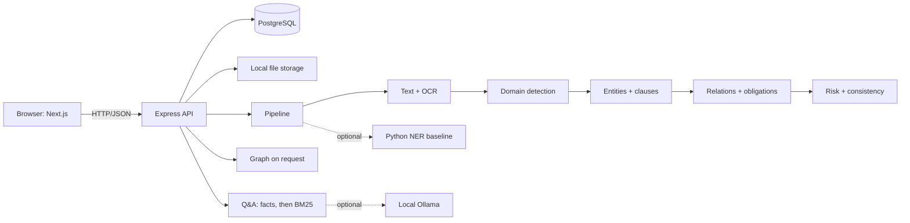

# NyayaLens

A local-first tool for reading Indian legal agreements. Upload a PDF or DOCX; NyayaLens extracts the parties, amounts, dates, obligations and clauses, flags provisions and inconsistencies for review, and answers questions about the text. Every item links to the exact text it came from. Nothing leaves your machine.

It is a research prototype and a reading aid, not legal advice.

## Problem and intended users

Agreements are long, and the terms that matter (a deposit, a notice period, who pays for repairs, a price stated two ways) are easy to miss. NyayaLens is for a student, tenant, small landlord or reviewer who wants a structured first read with the evidence in view, without sending the document to a third party.

## What is implemented

- Upload, text extraction (PDF, DOCX) and local OCR for scanned pages.
- Seven domains, thirteen document types (see the table below).
- Entities, clauses, relations and obligations, each with a character span.
- Domain detection that reports a mismatch with the chosen type.
- Risk rules and a consistency engine, worded as "potential issue / review required".
- Question answering: answers from extracted facts first, BM25 retrieval second. Every answer is GROUNDED or NOT SUFFICIENT, with clause and page.
- A knowledge graph of the document (filters, legend, selectable nodes, details panel).
- Document comparison, and a public `/research` page that reads the evaluation files.
- Owner-only access on every document endpoint; short-lived tokens; login throttling; configured CORS origins.

Not implemented: local embeddings or reranking, languages other than English, a fine-tuned model (an attempt failed; see the paper), a dark theme.

## Architecture



## Technology

Next.js 15, React 18, Tailwind, React Flow; Node.js, Express, TypeScript; PostgreSQL 16 with Prisma; pdfjs-dist, mammoth, tesseract.js; Vitest, pytest. Python is used only for the optional NER baseline (`services/ml`) and the dataset generator (`research/generator`).

## Workflow

1. **Ingest:** validate the file and declared type, extract text, OCR pages without text.
2. **Detect:** compare title and wording with the declared domain (signals only, no probability).
3. **Extract:** the domain's rules find entities and classify clause headings.
4. **Analyse:** relations and obligations; normalised amounts, dates and durations.
5. **Check:** per-clause and cross-clause risk rules; consistency rules for repeated values.
6. **Answer:** structured facts first, retrieval second.

Each domain is a data file (a DomainPack). Adding a domain does not change the pipeline: see `docs/domain_packs.md`.

## Domains and status

| Domain | Document types | Status |
|---|---|---|
| Residential rental | rental agreement | Implemented; used in the earliest evaluations |
| Land lease | land lease deed | Implemented |
| Leave and licence | leave and licence agreement | Implemented |
| Sale of property | agreement to sell, sale deed | Implemented |
| Builder-buyer | builder-buyer agreement | Implemented |
| Employment | contract, offer letter, appointment letter | Implemented |
| NDA / services | NDA, mutual NDA, service agreement, MSA | Implemented |

"Implemented" means the rules exist and pass synthetic benchmarks. No domain has been validated on real agreements.

## Repository layout

```
apps/api         Express API, pipeline, domain packs, risk and Q&A (src/), tests, scripts
apps/web         Next.js app (src/app pages, src/components, src/lib)
packages/db      Prisma schema, migrations, seed
services/ml      Optional Python NER baseline and evaluation scripts
research/        Dataset generator, generated data (git-ignored), reports, results
docs/            architecture, domain packs, dataset card, evaluation, setup, research paper
```

## Prerequisites

Node.js 20+ and npm 10+; Docker (for PostgreSQL 16) or your own PostgreSQL 16; Python 3.10+ only for the optional parts.

## Setup

```bash
npm install
cp .env.example .env          # then set the two JWT secrets (below)
docker compose up -d postgres
npm run db:generate
npm run db:migrate:deploy
npm run db:seed               # optional
npm run dev:api               # http://localhost:4000
npm run dev:web               # http://localhost:3000
```

Generate each secret (they must differ): `node -e "console.log(require('crypto').randomBytes(48).toString('hex'))"`.

Open http://localhost:3000, register, and upload a file.

## Environment variables

Defined in `.env.example` (never commit `.env`).

| Variable | Purpose |
|---|---|
| `DATABASE_URL` | PostgreSQL connection string |
| `JWT_ACCESS_SECRET`, `JWT_REFRESH_SECRET` | Token signing (min 32 chars, different values) |
| `JWT_ISSUER`, `JWT_AUDIENCE` | Token validation |
| `ACCESS_TOKEN_TTL_MINUTES`, `REFRESH_TOKEN_TTL_DAYS` | Token lifetimes |
| `CORS_ORIGINS` | Web origins allowed to call the API (default: localhost:3000) |
| `AUTH_LOGIN_MAX_FAILURES`, `AUTH_LOGIN_WINDOW_MINUTES` | Failed-login throttle |
| `STORAGE_ROOT`, `MAX_UPLOAD_SIZE_MB` | Upload storage and size limit |
| `NEXT_PUBLIC_API_BASE_URL` | API address used by the web app |
| `ML_SERVICE_PYTHON` | Optional: Python for the NER baseline (empty = skipped) |
| `LLM_PROVIDER`, `OLLAMA_*` | Q&A answerer: `extractive` (default) or local `ollama` |

If you run the web app on another port, add its origin to `CORS_ORIGINS`.

## Tests and checks

```bash
npm test                  # db, api (needs PostgreSQL running), web
npm run lint
npm run typecheck
npm run format            # prettier --check
cd services/ml && .venv/Scripts/python.exe -m pytest -q          # optional
cd research/generator && .venv/Scripts/python.exe -m pytest tests -q
```

`apps/api/tests/sampleAgreements.test.ts` runs four hand-written-style agreements end to end.

## Dataset and evaluation

The generator (`research/generator/generate_v3.py`) produces annotated synthetic agreements: 3,640 documents (seed 2027) across seven domains, with held-out test templates, adversarial and control pairs, counterfactual pairs, cross-domain documents and a 45,275-item question benchmark. A validator reports zero duplicates, near-duplicates and train/test leakage. Regenerate with `generate_v3.py --seed 2027`; run the evaluation with `cd apps/api && npx tsx scripts/evaluate-v3.mjs`.

Results on the seed-2027 data (`docs/evaluation.md`, micro-averaged; entities matched on exact span and label):

| Split | Entity F1 | Clause F1 | Relation F1 | Obligation F1 |
|---|---|---|---|---|
| Test (315 docs) | 0.994 | 0.985 | 0.986 | 0.914 |
| Cross-domain (140 docs) | 0.994 | 0.987 | 0.986 | 0.899 |

Question answering on the generated benchmark: 98.8% to 100% by question type. These are agreement with a generator written by the same team as the rules; they are **not** a measure of accuracy on real agreements.

## Limitations and known issues

- Evaluation is synthetic only. On four hand-written-style agreements the first run missed every party and date; those were fixed, but real documents will phrase things the rules do not cover.
- Clause labelling relies on headings; an unusual heading is missed and can cause a false "missing clause" finding.
- Obligations spread over several sentences are missed (recall about 0.87).
- Retrieval cannot tell a close but wrong passage from an answer.
- At phone width the graph is panned rather than fitted; use "Expand".
- Documents analysed before the semantic stages existed must be re-uploaded.
- English only. Legal-reference metadata is unverified.

## Security and privacy

Processing is local; no cloud AI is called by default. Documents are stored under `STORAGE_ROOT` and in PostgreSQL. Ownership is checked in the query that loads each document. Passwords use Argon2id; refresh tokens rotate and are revoked on reuse. Before any public deployment, review CORS, rate limits, HTTPS, retention, and the wording with a lawyer.

## Documentation

- Research paper: `docs/research_paper.md`
- Architecture: `docs/architecture.md`; domain packs: `docs/domain_packs.md`
- Dataset card: `docs/dataset_card.md`; evaluation: `docs/evaluation.md`
- Local setup details (offline NER model, Ollama): `docs/local_setup.md`
- Legal-reference policy: `docs/legal_reference_policy.md`; requirement map: `docs/full_spec.md`
