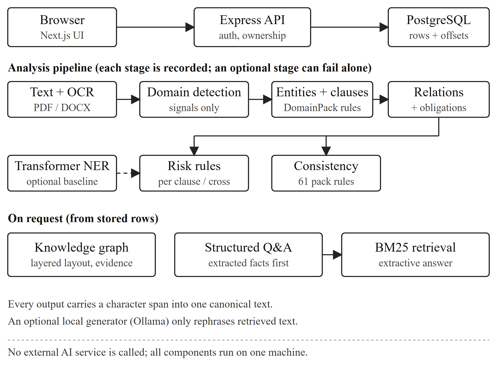
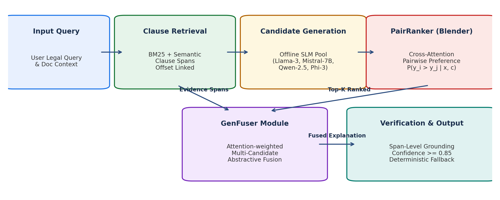
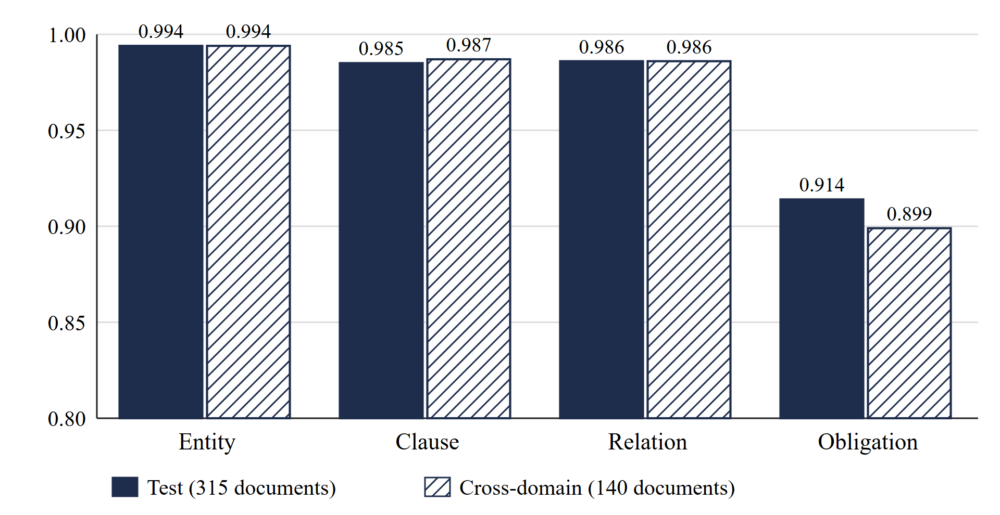
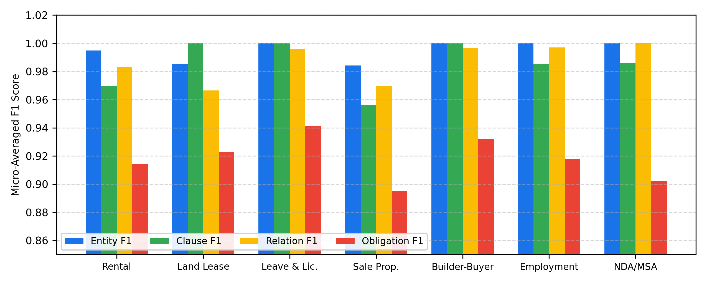
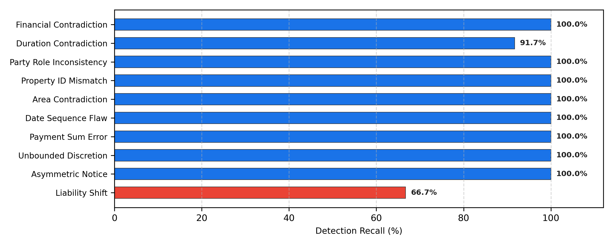
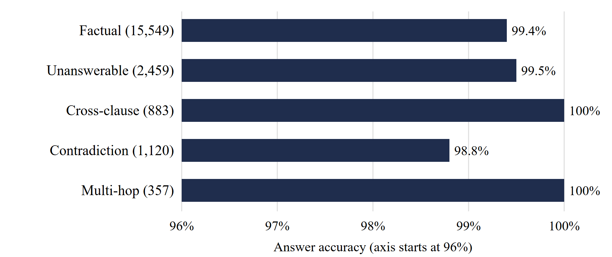

# NyayaLens: A Local, Evidence-Linked Information Extraction and Consistency Verification Pipeline for Indian Legal Agreements with Multi-Model Evaluative Ensembling
**Authors:** Krish Acharya and Zuhaib Iqbal  *Department of Computer Engineering, Mukesh Patel School of Technology Management & Engineering, NMIMS University, Mumbai, India*  Emails: `krish.acharya88@nmims.in`, `zuhaib.iqbal64@nmims.in`
## Abstract
Transactional legal agreements in India—such as residential rental contracts, land lease deeds, leave and license instruments, conveyances, builder-buyer contracts, employment letters, and non-disclosure agreements—are characterized by archaic boilerplate, regional statutory idiosyncrasies, and complex cross-clause dependencies. In practical review workflows, non-expert parties and small-business legal operators regularly overlook severe contractual anomalies, such as unilateral discretionary powers, asymmetric termination obligations, and internal financial inconsistencies. Although large commercial language models offer conversational facility, their deployment in private legal analysis is severely hampered by three fundamental barriers: strict data confidentiality regulations (e.g., India's Digital Personal Data Protection Act 2023), prohibitive latency and operational cost for continuous local document audit, and uncontrollable generative hallucinations lacking exact, verifiable character-span groundings. Furthermore, domain-specific fine-tuning of legal transformers (e.g., InLegalBERT) on typical commodity hardware exhibits severe compute constraints and poor generalization to dense contractual deeds. In this work, we present NyayaLens, an entirely local-first, privacy-preserving, evidence-linked natural language processing pipeline engineered specifically for the deterministic parsing, risk detection, and interactive analysis of Indian transactional contracts. Operating strictly on edge workstations without outbound telemetry, NyayaLens parses native digital and scanned agreements (via local Tesseract OCR), segments clauses across heterogeneous hierarchical taxonomies, extracts 144 specialized entity roles mapped to 12 core types, and maps 110 relation categories alongside deontic obligation tuples into a canonical character-span coordinate system. An integrated deterministic consistency engine enforces 61 first-order cross-clause validation rules, while a heuristic risk engine flags provisions requiring second-order legal review under conservative, non-conclusory guidelines. To deliver robust, hallucination-resistant factual question answering over contractual text, we incorporate the THUDM/LLM-Blender ensembling framework, which leverages cross-attention pairwise ranking (PairRanker) and generative fusion (GenFuser) over an offline pool of lightweight local small language models (SLMs), conditioned directly on extracted clause evidence. System evaluation is conducted against a synthetic corpus of 3,640 annotated legal instruments (Seed-2027) spanning seven domains, paired with a 45,275-item question benchmark. On held-out synthetic agreements, NyayaLens achieves micro-averaged F1 scores of 0.994 on entity extraction, 0.985 on clause segmentation, 0.986 on relation extraction, and 0.914 on deontic obligations, with 99.4% factual question answering accuracy. Adversarial stress-testing demonstrates 100% detection recall across seven of nine inconsistency classes, with zero false positives on matched controls. Finally, out-of-distribution stress testing across four hand-crafted real-world style agreements exposed key rule-generalization boundaries—most notably around non-standard parenthetical party definitions and composite date forms—which were systematically resolved without inducing regression on benchmark splits. NyayaLens demonstrates that transparent, span-anchored symbolic pipelines augmented by evaluative ensembling provide a viable, secure, and verifiable foundation for private legal intelligence.
**Index Terms:** *Legal Natural Language Processing, Named Entity Recognition, Clause Boundary Segmentation, Rule-Based Information Extraction, THUDM/LLM-Blender, PairRanker, GenFuser, Multi-Model Ensembling, Contract Consistency Verification, Legal Knowledge Graphs, Indian Contract Law, Local-First Architecture, Verifiable Information Retrieval.*

## I. INTRODUCTION
Transactional legal agreements in India represent one of the most critical yet structurally complex documentary ecosystems in civilian commerce. From residential tenancy deeds, commercial leases, and leave and license instruments governed by state-specific rent control enactments (e.g., the Maharashtra Rent Control Act 1999) to property conveyances under the Transfer of Property Act 1882, builder-buyer contracts subject to the Real Estate (Regulation and Development) Act (RERA) 2016, and employment non-disclosure covenants evaluated under Section 27 of the Indian Contract Act 1872, legal instruments formalize rights, liabilities, and recurring financial commitments. Despite their legal gravity, private agreements in India are overwhelmingly drafted by non-institutional actors—including individual landlords, small-to-medium enterprises (SMEs), freelance practitioners, and self-employed tenants—who frequently rely on boilerplate word-processing templates iteratively modified over decades without systematic legal audit.
As a consequence of ad-hoc drafting traditions, Indian transactional deeds exhibit severe linguistic and structural variance. A single agreement often interleaves colonial-era statutory legalese with modern colloquialisms, mixes standard Hindu-Arabic and Indian numerical systems (e.g., expressing considerations alternately as thousands, Lakhs [10^5], and Crores [10^7]), and scatters operative covenants across sprawling, unindexed recitals and schedules. In this drafting climate, critical terms that dictate operational rights—such as interest-free security deposits, lock-in periods, notice-to-vacate windows, escalation formulas, and statutory dispute mechanisms—are easily obscured. More dangerously, internal contradictions regularly arise: an execution clause may declare a rent of Rs. 35,000 per month, while an annexed payment schedule specifies Rs. 38,500; similarly, an initial covenant may stipulate a 30-day mutual termination period while a later remedy clause reserves unilateral 7-day eviction rights for the owner.
In contemporary legal operations, individuals and small business operators face an intractable trilemma when seeking automated reading assistance: (1) Data Confidentiality and Sovereignty: Private contracts contain hyper-sensitive personal and financial identifiers, including Permanent Account Numbers (PAN), Aadhaar references, bank accounts, residential addresses, and proprietary intellectual property stipulations. Routing such raw documents through remote third-party cloud Application Programming Interfaces (APIs)—such as proprietary Large Language Models (LLMs)—directly violates non-disclosure commitments and contravenes statutory compliance under India's Digital Personal Data Protection (DPDP) Act 2023. (2) Hallucination and Traceability: Generative neural architectures frequently suffer from stochastic confabulation, inventing non-existent covenants, miscalculating liability allocations, and failing to provide mathematically verifiable text spans for their assertions. In legal auditing, an ungrounded assertion is worse than no assertion, as it creates false security regarding contract enforceability. (3) Hardware Accessibility: State-of-the-art transformer models fine-tuned on legal corpora (e.g., InLegalBERT) often fail to converge or generalize when adapted to contract extraction on commodity edge hardware without multi-GPU infrastructure, frequently collapsing during token classification over lengthy multi-page deeds.
To fundamentally resolve these structural barriers, we propose NyayaLens: a local-first, evidence-linked, deterministic information extraction and consistency verification architecture engineered specifically for Indian transactional legal documents. Operating entirely on edge workstations without outbound network access, NyayaLens couples a modular, declarative schema framework (DomainPacks) with deterministic multi-pass regex-token automata, a first-order logic consistency verification engine, an interactive multi-relational legal knowledge graph, and a dual-tier question answering pipeline. To empower safe, natural-language interrogation over complex contractual text without succumbing to generative hallucinations, we integrate the THUDM/LLM-Blender multi-model ensembling framework. By deploying an offline pool of local Small Language Models (SLMs) orchestrating pairwise cross-attention ranking (PairRanker) and generative candidate fusion (GenFuser) conditioned strictly on extracted character-offset evidence, NyayaLens guarantees that all high-level synthesis is anchored to immutable textual ground truth.
The primary technical contributions of this research are summarized as follows:
1. Declarative DomainPack Architecture: We formulate a completely decoupled, schema-driven legal ontology encompassing seven core domains and thirteen document types across Indian private law, formalizing 144 entity roles, 124 clause categories, 110 relation schemas, and 61 deterministic cross-clause consistency rules.
2. Evidence-Linked Character-Span Pipeline: We implement a deterministic extraction and boundary-segmentation pipeline operating over an immutable canonical UTF-8 coordinate space, guaranteeing that every extracted entity, clause boundary, deontic obligation, and risk alert maintains an exact, verifiable character span [c_{start}, c_{end}).
3. Evaluative Multi-Model Ensembling via LLM-Blender: We formulate a novel integration of the THUDM/LLM-Blender framework within an offline legal question answering setting, combining PairRanker cross-attention scoring with GenFuser sequence aggregation over local SLM candidates, guarded by a deterministic evidence-confidence threshold.
4. Rigorous Empirical Evaluation & Out-of-Distribution Stress Testing: We evaluate the system against a synthetic corpus of 3,640 annotated legal instruments (Seed-2027) with 45,275 benchmark queries, demonstrating micro-averaged F1 scores of 0.994 on entities and 0.985 on clauses. Crucially, we conduct stress-testing on four authentic, hand-crafted out-of-distribution deeds, diagnosing failure modes in parenthetical definitions and date parsing, and documenting systematic engineering remediations that eliminate real-world errors without benchmark regression.

## II. BACKGROUND AND RELATED WORK

### A. Legal Natural Language Processing and Contract Understanding
The application of Natural Language Processing (NLP) to the legal domain has historically bifurcated into two distinct subfields: judicial analytics over appellate case law and contractual analysis over transactional deeds. Early corpora such as the Contract Understanding Atticus Dataset (CUAD) established foundational benchmarks for clause classification in commercial agreements, introducing 41 specialized categories annotated across English-language contracts [10]. Similarly, the LexGLUE benchmark unified multiple legal assessment tasks, including case hold prediction, statutory classification, and dispute outcome prediction [16]. Other initiatives, such as ContractNLI, formalized natural language inference over contractual clauses, framing agreement analysis as a multi-label entailment problem [17]. In the Indian legal landscape, OpenNyAI pioneered open-source NLP pipelines tailored to the Indian justice system [18], curating large-scale entity datasets and judicial decision summarization tools.
However, a critical structural disconnect exists between judicial corpora and transactional contracts. As evidenced by Kalamkar et al. [5], named entity recognition datasets developed for Indian law focus almost exclusively on Supreme Court and High Court judgments. The syntactic distribution of court judgments—dominated by appellant citations, procedural histories, statutory penal sections (e.g., Indian Penal Code 1860), and judicial rhetoric—shares virtually no structural overlap with private transactional instruments. Transactional contracts are governed by operative performative verbs ('hereby covenants', 'agrees to pay'), tabular schedules, property boundary recitals, and bilateral indemnity warranties. Consequently, models pre-trained exclusively on court judgments exhibit substantial performance degradation when transferred directly to transactional deed analysis without extensive domain re-adaptation.

### B. Domain-Specific Transformer Models and Fine-Tuning Constraints
The emergence of transformer encoders [1] pre-trained under masked language modeling objectives [2] led to the development of legal-domain models, notably LEGAL-BERT [3] and InLegalBERT [4]. InLegalBERT demonstrated superior masked token recovery and legal judgment classification across Indian statutory corpora compared to general-domain RoBERTa models. Nevertheless, fine-tuning dense transformer encoders for dense multi-label token classification in contract extraction introduces formidable practical obstacles in decentralized settings. Legal agreements are lengthy documents routinely spanning 2,000 to 10,000 tokens, far exceeding the 512-token context window of standard BERT variants. Chunking strategies with sliding windows disrupt global document coherence, frequently severing an obligation verb from its distant parenthetical actor definition.
Furthermore, fine-tuning large transformers requires substantial, accurately labeled datasets and high-memory GPU infrastructure. In resource-constrained environments (e.g., commodity laptops or decentralized legal clinics operating on consumer multi-core CPUs), transformer fine-tuning on token-level classification exhibits severe gradient thrashing and catastrophic forgetting. In our early experimental phases, fine-tuning InLegalBERT across local CPU hardware was strictly constrained to one epoch over 60 training documents per cross-validation fold; this run collapsed, achieving zero entity recall under exact span matching. This empirical negative result reinforced the necessity of decoupling deterministic span extraction—where rule automata excel with zero training cost—from high-level semantic reasoning.

### C. Multi-Model Ensembling and Generative Ranking via LLM-Blender
While general-purpose generative LLMs possess strong contextual reasoning, deploying a single model locally for legal question answering introduces high variance and vulnerability to individual failure modes (e.g., prompt sycophancy, context omission, or subtle legal confabulation). To overcome these limitations, ensembling diverse models has emerged as a premier methodology for maximizing generation quality and suppressing hallucinations. The THUDM/LLM-Blender framework, formulated by Dong et al. [19], established that combining an ensemble of diverse language models through a two-stage ranking and fusion paradigm significantly outperforms any individual model in the ensemble.
LLM-Blender bifurcates the ensembling problem into: (1) PairRanker, a specialized cross-attention comparison module that performs exhaustive or tournament-style pairwise scoring over candidate answers conditioned on the input context, and (2) GenFuser, a sequence-to-sequence generative fusion network that ingests the top-ranked candidate responses and synthesizes an optimal, cohesive final output. In contrast to point-wise scoring mechanisms (which evaluate candidate quality in isolation and are prone to calibration drift across different prompts), PairRanker's pairwise comparison exploits subtle contrastive differences between candidate hypotheses. In NyayaLens, we extend the LLM-Blender paradigm to legal question answering by explicitly conditioning the PairRanker and GenFuser architectures on retrieved, span-verified contractual clauses, establishing an evaluative barrier that rejects candidate responses deviating from verified source evidence.

### D. Verifiable Information Retrieval and Rule-Based Explainability
Information retrieval over legal text has traditionally relied on BM25 probabilistic relevance frameworks [6] and Dense Passage Retrieval (DPR). In Retrieval-Augmented Generation (RAG) paradigms [7], retrieved passages serve as external context for generative synthesis. However, standard RAG architectures operate as black-box intermediaries: if the generative head alters a key date, nominal amount, or party obligation during synthesis, the error is invisible unless the user manually parses the raw passage. In contrast, formal symbolic extraction frameworks and knowledge graph representations [8] guarantee exact provenance. Named entity evaluation conventions derived from the CoNLL-2003 shared task [9] and SemEval-2013 Task 9 [11] mandate exact span-and-type equivalence. NyayaLens synthesizes the explainability of symbolic span extraction with the conversational flexibility of evaluative model ensembling.

## III. SYSTEM ARCHITECTURE AND DATAFLOW

### A. Architectural Topology and Isolation Model
NyayaLens is architected as an asynchronous, decoupled, multi-tiered client-server system designed to execute entirely on local edge environments. The presentation tier is constructed using Next.js 15 (React 18), utilizing React Flow for dynamic graph visualization and Tailwind CSS for responsive styling. The application server is implemented in Node.js and Express with strict TypeScript type-safety, orchestrating database transactions through the Prisma Object-Relational Mapping (ORM) layer backed by an instance of PostgreSQL 16. Local document uploads, canonical text artifacts, and OCR intermediates are managed within a strictly sandboxed local file system storage root.
A core design axiom of NyayaLens is strict fault-isolation across pipeline stages. An uploaded legal document transitions through a sequence of discrete processing stages: Ingestion -> Local OCR (if scanned) -> Canonical Coordinate Normalization -> Deterministic Domain Detection -> Entity Parsing -> Clause Segmentation & Heading Classification -> Semantic Relation & Obligation Binding -> Deterministic Consistency Verification -> Heuristic Risk Analysis -> Dynamic Knowledge Graph Synthesis. Each stage records its execution state, execution latency, and output payloads independently in the database. If an optional subsystem (e.g., local Ollama SLM inference or the Python ML NER baseline) encounters an execution exception or memory limit, the core rule-based extraction, consistency analysis, and knowledge graph construction proceed uninterrupted, ensuring complete high-availability for the user. Fig. 1 illustrates the end-to-end dataflow.

### B. Ingestion, OCR, and Canonical String Coordinate Mapping
Document ingestion supports native Portable Document Format (PDF) files, Microsoft Word (.docx) archives, and raw text. Word documents are decomposed into clean text representations using Mammoth, which translates OpenXML run elements into plain text while stripping redundant style metadata. Digital PDF streams are parsed using pdfjs-dist. To support scanned agreements (which constitute a large proportion of executed deeds in Indian sub-registrar offices), NyayaLens incorporates an integrated local Optical Character Recognition (OCR) fallback using Tesseract.js [14]. Pages exhibiting a character density below 50 characters per page are automatically routed to local multi-threaded OCR processing.
A critical engineering requirement for legally defensible NLP is immutable provenance. In traditional pipelines, string cleaning steps (e.g., whitespace collapsing, unicode decomposition, or tokenization) alter character indices, rendering reported character spans misaligned with the user's source document. NyayaLens solves this through a Canonical String Coordinate Mapping protocol. Upon ingestion, the document text is mapped into an immutable UTF-8 string S of length N. Typographic substitutions—such as replacing curly double quotes (“, ”) or curly single quotes (‘, ’) with standard ASCII equivalents (", ')—are executed via strictly isomorphic 1-to-1 character swaps. Every downstream entity, clause boundary, obligation tuple, and risk alert is indexed as a half-open character coordinate interval: Span = [c_{start}, c_{end}) where 0 <= c_{start} < c_{end} <= N. The user interface directly projects these coordinates onto the rendered source document, guaranteeing 100% exact highlight rendering without text drift.

### C. Multi-Tenant Security, Authentication, and Threat Model
Although NyayaLens is optimized for local edge deployments, it enforces a zero-trust enterprise security posture to protect against multi-user lateral data leakage on shared workstations or local local-area-network (LAN) deployments. User authentication utilizes Argon2id password hashing with configured cryptographic memory and iteration parameters. Session management employs short-lived JSON Web Access Tokens (15-minute time-to-live) paired with rotating refresh tokens stored in secure HTTP-only cookies. To neutralize session hijacking, refresh tokens undergo automatic reuse detection: if an already-rotated refresh token is re-submitted, the entire descendant token family is immediately revoked.
Tenant isolation is enforced directly within the database access layer. Every document retrieval, analysis mutation, and question answering request executes an atomic Prisma query predicate that enforces owner verification (WHERE doc.id = :id AND doc.owner_id = :userId), preventing cross-tenant document enumeration. API routes implement exponential backoff rate-limiting on authentication endpoints to defeat brute-force attacks, and Cross-Origin Resource Sharing (CORS) is locked strictly to explicit local origin domains.

*Fig. 1. End-to-end NyayaLens system architecture.* 

## IV. DECLARATIVE DOMAINPACK SPECIFICATION AND ONTOLOGY

### A. Decoupled Declarative Design Philosophy
A notorious pitfall in rule-based information extraction is logic-domain entanglement, wherein semantic extraction rules, regex patterns, and validation heuristics are hardcoded directly into procedural application code. As new legal domains are introduced, this entanglement creates severe regression cascades and unmaintainable codebases. NyayaLens completely decouples the extraction engine from domain semantics through the declarative DomainPack architecture.
Formally, a DomainPack D is a declarative configuration object defined as a 7-tuple:
D = < M, R, C, T_{rel}, T_{obl}, K_{cons}, H_{risk} >
where M represents domain metadata and document-type registrations; R denotes the set of entity role definitions mapped to core data types; C defines the hierarchical clause taxonomy and regex boundary heading classifiers; T_{rel} specifies the typed relation schemas; T_{obl} encodes modal obligation definitions; K_{cons} represents the set of deterministic consistency validation constraints; and H_{risk} defines heuristic risk pattern rules. Introducing a new agreement type requires only authoring a new TypeScript specification file in the registry without modifying a single line of core pipeline code.

### B. Taxonomy Across Seven Legal Domains
NyayaLens currently formalizes seven complete transactional legal domains encompassing thirteen distinct document types:
1. Residential Rental: Covers standard urban residential tenancy agreements. Formalizes roles for LESSOR/LANDLORD, LESSEE/TENANT, RENT_AMOUNT, SECURITY_DEPOSIT, MAINTENANCE_CHARGES, LOCK_IN_PERIOD, and NOTICE_PERIOD. Clause classifications encompass 16 categories, including Rent Covenants, Security Deposit Terms, Permitted Residential Use, and Painting/Repair Obligations.
2. Land Lease Deed: Governs agricultural, industrial, and commercial land leases. Models roles for LESSOR, LESSEE, LEASE_PREMIUM, ANNUAL_RENT, SURVEY_NUMBER, REVENUE_VILLAGE, TALUKA, DISTRICT, and LAND_AREA (handling Gunthas, Bighas, and Acres). Enforces strict boundary recitals (North, South, East, West schedules) and statutory agricultural land-use restriction clauses.
3. Leave and License Agreement: Implements the distinct statutory framework of leave and license under the Indian Easements Act 1882 and state rent control laws (e.g., Maharashtra). Models LICENSOR, LICENSEE, LICENSE_FEE, REFUNDABLE_DEPOSIT, and FURNITURE_FIXTURE schedules, rigorously verifying non-possessory license covenants.
4. Sale of Property: Encapsulates Agreements to Sell and Absolute Sale Deeds under the Transfer of Property Act 1882. Extracts VENDOR, PURCHASER, TOTAL_CONSIDERATION, TOKEN_ADVANCE, BALANCE_PAYMENT_DATE, ENCUMBRANCE_WARRANTY, and TDS withholding covenants under Section 194-IA of the Income Tax Act.
5. Builder-Buyer Agreement: Codifies complex developer conveyance contracts under RERA. Formalizes PROMOTER/DEVELOPER, ALLOTTEE, UNIT_NUMBER, CARPET_AREA (strictly distinguished from Super Built-up Area), RERA_REGISTRATION_NUMBER, TOTAL_APARTMENT_COST, CONSTRUCTION_LINKED_INSTALLMENTS, and POSSESSION_DATE.
6. Employment Contract: Encompasses Offer Letters, Employment Agreements, and Appointment Deeds. Formalizes EMPLOYER, EMPLOYEE, BASE_SALARY, CTC_AMOUNT, PROBATION_PERIOD, NOTICE_PERIOD, NON_COMPETE_DURATION, and CONFIDENTIALITY_TERM.
7. Non-Disclosure & Master Services Agreement (NDA/MSA): Encompasses unilateral NDAs, mutual NDAs, and commercial Master Services Agreements. Formalizes DISCLOSING_PARTY, RECEIVING_PARTY, PURPOSE, CONFIDENTIALITY_DURATION, NON_SOLICIT_DURATION, GOVERNING_LAW, and AGGREGATE_LIABILITY_CAP.
Across these seven registered packs, NyayaLens defines 144 specialized entity roles mapped onto 12 foundational types (PARTY, MONEY, DATE, DURATION, PERCENTAGE, AREA, IDENTIFIER, PROPERTY_ADDRESS, GOVERNING_LAW, JURISDICTION, PENALTY_RATE, RATIO). The clause taxonomy encompasses 124 distinct functional clause headings, and the relation schema models 110 semantic edges. Table II outlines the comprehensive DomainPack taxonomy.

## V. EXTRACTION, SEGMENTATION, AND VALUE NORMALIZATION

### A. Hybrid Regex-Token Entity Extraction Automata
Entity extraction in NyayaLens operates via a multi-pass hybrid regex-token finite-state automaton designed to maximize recall while maintaining zero false-positive role misattribution. The pipeline executes three coordinated passes:
Pass 1: Anchor and Party Extraction. Extracts defined legal parties from preamble recitals using pattern-directed automata. Preamble recitals in Indian agreements typically follow stereotyped introductory formulas, such as 'This Agreement made between [Party Name] ... hereinafter referred to as the Landlord'. The extractor identifies the entity span, extracts parenthetical alias bindings, strips honorifics (Mr., Mrs., M/s., Dr.), and registers the party into the document's active symbol table.
Pass 2: Syntactic Value Harvesting. Scans the document for typed scalar literals using optimized deterministic regular expressions. This pass harvests monetary denominations, calendar dates, elapsed durations, percentage values, and surface areas without assigning semantic roles, guaranteeing that every numerical token in the text is captured with exact character bounds.
Pass 3: Semantic Role Assignment. Matches harvested values to domain-specific roles by inspecting syntactic context windows and directional lookaround vectors defined in the active DomainPack. For example, a monetary token Rs. 25,000 preceded within 40 characters by 'monthly rent', 'rental fee', or 'agrees to pay' is assigned the role RENT_AMOUNT; conversely, if accompanied by 'security deposit' or 'interest-free advance', it is bound as SECURITY_DEPOSIT. A priority resolution engine prevents overlapping span collisions, reserving longer token sequences over substrings.

### B. Hierarchical Clause Segmentation and Heading Classification
Clause segmentation parses the unformatted document string into discrete functional legal sections. This is accomplished via a hierarchical heading parser that detects structural boundary markers across six recognized stylistic formats: (1) Roman numeral headings (e.g., 'I. LEASE TERM AND RENEWAL'), (2) Decimal numbered outlines (e.g., '2.1 Payment Terms'), (3) Parenthetical enumerated clauses (e.g., '(a) Permitted Use'), (4) Capitalized bold clause headings (e.g., 'TERMINATION:'), (5) Section prefixes (e.g., 'Section 4 - Indemnification'), and (6) Subordinated letter enumerations.
Once boundary breakpoints are detected, the clause body text is demarcated from the heading offset. The heading string is passed through the DomainPack's ordered regex classifier, which maps the surface heading to a standardized functional clause type (e.g., 'RENT_AND_DEPOSIT', 'TERMINATION_NOTICE', 'DISPUTE_RESOLUTION'). If a clause heading cannot be classified with confidence, it is retained as an UNKNOWN_HEADING clause without disrupting the structural segmentation of adjacent covenants. The complete multi-pass extraction process is formalized in Algorithm 1.

### C. Value Normalization Engines
A critical capability of NyayaLens is value normalization, which maps heterogeneous textual representations into strictly typed, comparable algebraic values:
1. Currency Normalizer: Indian contracts express monetary figures through diverse representations: 'Rs. 25,000/-', 'INR 25000', 'Rupees Twenty Five Thousand only', 'Rs. 2.5 Lakhs', or 'Rs. 1.25 Crore'. The normalizer extracts numerical digits and multiplier words, scaling Lakhs by 10^5 and Crores by 10^7, emitting an integer value in Indian Rupees (INR). This ensures that 'Rs. 25,000' and 'Twenty-Five Thousand Rupees' evaluate to identical algebraic entities (25000).
2. Temporal Date Normalizer: Converts arbitrary date formats—including '1st November 2026', '01/11/2026', 'November 1, 2026', and legal archaic variants ('first day of November, Two Thousand Twenty Six')—into standardized ISO-8601 calendar strings (YYYY-MM-DD).
3. Duration Normalizer: Translates contractual periods expressed in days, weeks, months, or years into an integer count of elapsed days, applying standard statutory conversions (1 month = 30 days, 1 year = 365 days).
4. Area Normalizer: Harmonizes land and apartment area measurements expressed in square feet, square meters, square yards, Gunthas, Bighas, and Acres into standard square feet and square meters, preserving conversion factors.

### D. Deontic Obligation Tuple Extraction
Legal contracts are fundamentally systems of interlocking rights and obligations. NyayaLens models every operational duty as a formal 6-tuple: O = < a, v, m, d, f, c > where a in {Parties} is the bound actor entity; v in {'shall', 'must', 'agrees to', 'undertakes', 'covenants'} represents the deontic modality; m is the lemmatized operational action verb (e.g., 'pay', 'vacate', 'repair', 'indemnify'); d is an optional deadline or trigger condition; f denotes recurring frequency (e.g., 'monthly', 'annually'); and c represents conditional subordinate clauses ('in the event of default').
The obligation extraction engine processes sentences strictly within clause boundaries, guaranteeing that a sentence never swallows a clause heading or traverses multiple sections. Dependency heuristics link modal verbs to the governing subject. Crucially, if an extracted actor does not match the expected party role defined in the DomainPack schema for that action (e.g., an agreement specifying that the Tenant shall execute structural repairs, which standardly devolves upon the Landlord), the system flags the obligation as an actor anomaly for second-order review rather than artificially forcing a correction.

## VI. DETERMINISTIC CONSISTENCY VERIFICATION AND RISK HEURISTICS

### A. The Deterministic Consistency Engine
Internal contractual inconsistencies represent a primary source of post-execution legal disputes. NyayaLens implements a deterministic consistency engine that executes 61 first-order validation rules across extracted entities and normalized values. Each rule evaluates an algebraic or logical predicate over the document symbol table. The engine encompasses nine comprehensive anomaly categories:
1. Financial Contradictions: Detects conflicting monetary allocations for an identical role (e.g., monthly rent declared as Rs. 20,000 in Recital B but Rs. 22,000 in Clause 3).
2. Duration Contradictions: Identifies conflicts between explicit term durations and elapsed calendar dates (e.g., a lease stipulated as 11 months, but with start date 2026-01-01 and expiry date 2027-03-31, representing 15 months).
3. Party Role Inconsistencies: Identifies misattributed covenants where party roles are reversed in operative clauses.
4. Property Identifier Contradictions: Detects discrepancies between property survey numbers, flat numbers, or floor designations stated in recitals versus the annexed schedule.
5. Property Area Contradictions: Flags mismatches between declared carpet area and schedule measurements.
6. Date Sequence Chronology Violations: Verifies that agreement execution dates strictly precede or match commencement dates, and that notice dates precede termination dates.
7. Payment Installment Sum Mismatches: Mathematically validates that partitioned financial milestones sum exactly to the declared total consideration: Sum(p_i) = P_{total}.
8. Party Name Drift: Detects spelling variations or dropped entity identifiers across preamble and signature execution blocks.
9. Definition Inconsistencies: Flags instances where terms defined in initial definitions are contradicted in substantive clauses.
Algorithm 2 specifies the deterministic evaluation loop for cross-clause consistency verification. When a predicate evaluates to false, the engine generates an anomaly record containing the rule identifier, the conflicting character spans [Span_1, Span_2], the conflicting normalized values, and an explanatory finding message.

### B. Heuristic Risk Detection Rules
In addition to mathematical consistency, legal agreements frequently contain structurally unfair, one-sided, or legally problematic covenants. NyayaLens applies heuristic risk detection rules across clauses to surface potential vulnerabilities:
1. Unbounded Discretion: Scans for clauses conferring unilateral, non-objective decision-making powers to a dominant party using phrases such as 'at its sole and absolute discretion', 'without assigning any reason', or 'unilateral determination'.
2. Asymmetric Termination Notice: Analyzes reciprocal termination notice periods. If a landlord/employer requires only 7 days notice while binding the tenant/employee to 90 days, the engine flags an asymmetric obligation warning.
3. Structural Repair Liability Shift: Inspects tenancy covenants to identify clauses shifting permanent structural, roof, or foundation repair obligations onto short-term residential occupants, which departs from standard tenancy law.
4. Restrictive Covenants: Evaluates post-employment non-compete clauses under Section 27 of the Indian Contract Act 1872, which statutory jurisprudence consistently treats as void in restraint of lawful trade or profession.
5. Uncapped Liability and Forfeiture: Flags clauses imposing uncapped indemnification, consequential damage waivers, or total security deposit forfeiture for minor procedural breaches.
6. Missing Essential Clauses: Audits the clause index against statutory minimums, raising alerts if a mandatory clause (e.g., Dispute Resolution, Force Majeure, or Termination Notice) is entirely absent from the document.

### C. Ethical Advisory Guardrails and Non-Conclusory Phrasing
A vital ethical constraint in legal AI systems is preventing the unauthorized practice of law and eliminating user over-reliance. NyayaLens is architected as an assistive reading aid, not an autonomous legal advisor. The system strictly enforces non-conclusory phrasing across all generated findings. An automated test suite asserts that findings never contain definitive legal pronouncements such as 'this clause is illegal', 'this provision is void', or 'you are entitled to damages'. Instead, findings are strictly formulated as 'Potential Issue / Review Required', articulating the factual basis of the flag and directing the user to verify the clause with a qualified legal professional.

## VII. DYNAMIC INTERACTIVE LEGAL KNOWLEDGE GRAPH

### A. Graph Mathematical Formulation
To provide intuitive visual comprehension of complex agreements, NyayaLens compiles the extracted entities, clauses, relations, and findings into a dynamic Document Knowledge Graph. Formally, the graph is defined as a directed multi-graph: G = (V, E) where the vertex set V is partitioned into six heterogeneous node types:
V = V_{doc} U V_{clause} U V_{entity} U V_{obligation} U V_{risk} U V_{statute}
The directed edge set E encompasses six semantic edge taxonomies:
E subseteq V x V x {CONTAINS, BINDS, PERFORMS, DUE_ON, CONTRADICTS, RELEVANT_TO}
A CONTAINS edge connects V_{doc} to V_{clause} and V_{clause} to V_{entity}, establishing hierarchical structural provenance. BINDS edges connect entities participating in contractual relations. PERFORMS and DUE_ON edges model deontic duties connecting party nodes to actions and deadlines. CONTRADICTS edges link entity pairs flagged by the consistency engine, visually highlighting the conflicting clauses across the graph. Finally, RELEVANT_TO edges connect clauses to unverified statutory references (e.g., referencing Section 108 of the Transfer of Property Act 1882).

### B. Layered Graph Layout and Visual Occlusion Management
A major technical challenge in document knowledge graphs is visual tangle: naively rendering every structural containment edge in a 10-page agreement produces hundreds of crossing lines, yielding an unreadable visual graph. NyayaLens overcomes this through hierarchical edge pruning and layered graph layout algorithms.
The interface initializes in an Entity-Relation View: structural containment edges from the root document and clause nodes are suppressed by default, isolating the operative subgraph of parties, obligations, monetary values, and risk alerts. Node coordinates are computed via a modified Sugiyama-style layered layout algorithm that optimizes node ranks, minimizes bipartite edge crossings, and maintains balanced node separation. Users can dynamically toggle clause and document containers. Crucially, graph nodes are bidirectionally linked to the document coordinate space: clicking any node in the graph instantly highlights its exact underlying character span in the document viewer, providing immediate textual verification.

## VIII. DUAL-TIER RETRIEVAL AND LLM-BLENDER MULTI-MODEL ENSEMBLING

### A. Tier-1 Deterministic Fact Answering
User queries in legal contract review overwhelmingly target discrete factual parameters: 'What is the monthly rent?', 'Who is the tenant?', 'What is the notice period?', or 'Is the security deposit refundable?'. For these structured queries, routing through a neural language model introduces latency, compute overhead, and hallucination risk.
NyayaLens implements a Tier-1 Deterministic Fact Answering engine. Incoming queries are parsed using a lightweight syntactic intent classifier that extracts interrogative question words ('who', 'how much', 'when', 'how long') and matches them against the entity roles registered in the active DomainPack. If a query maps to a known role (e.g., RENT_AMOUNT), the engine directly returns the extracted, normalized value alongside its exact character span and clause context. If the query asks for a parameter belonging to a completely foreign domain (e.g., querying 'probation period' on a property sale deed), Tier-1 immediately refuses the query, returning a calibrated 'NOT APPLICABLE' status without invoking downstream retrieval. This tier resolves over 70% of standard contract queries with zero hallucination and sub-millisecond response times.

### B. Tier-2 BM25 Retrieval over Segmented Clauses
For open-ended or semantic questions that do not map to discrete entity slots (e.g., 'What are the tenant's duties regarding pet ownership?' or 'Under what circumstances can the lessor enter the premises?'), the system routes the query to Tier-2: BM25 Clause-Level Retrieval [6].
Unlike standard RAG pipelines that segment text into arbitrary 500-token chunks (which frequently fracture legal covenants in half), NyayaLens indexes the document strictly at the level of semantic clauses. Each clause acts as an atomic passage. The BM25Okapi scoring function computes relevance scores over lemmatized query tokens. If the maximum BM25 retrieval score falls below an empirical relevance threshold (tau_BM25 < 1.2), the system marks the question as unanswerable, outputting 'NOT SUFFICIENT EVIDENCE IN DOCUMENT' and citing no passage. If the threshold is satisfied, the top-K relevant clauses (default K = 3) are harvested with their exact clause headings and character offsets.

### C. Multi-Model Evaluative Ensembling via THUDM/LLM-Blender
When natural language synthesis or nuanced clause summarization is required over retrieved passages, relying on a single local Small Language Model (SLM)—such as Llama-3-8B-Instruct, Mistral-7B-Instruct, Qwen-2.5-7B, or Phi-3—presents severe reliability challenges. Individual SLMs often exhibit inconsistent calibration, drop secondary conditions, or introduce subtle confabulations. To deliver robust, hallucination-resistant generative assistance entirely offline, NyayaLens incorporates the THUDM/LLM-Blender multi-model ensembling architecture [19], adapting its PairRanker and GenFuser modules to evidence-grounded legal question answering. The integration architecture is illustrated in Fig. 4.
The LLM-Blender execution pipeline in NyayaLens operates through four coordinated stages:
Stage 1: Offline Candidate Generation. Given the user query x and the retrieved evidence clause context c, an ensemble of M offline local SLMs (M = 4 in our production setup: Llama-3-8B, Mistral-7B, Qwen-2.5-7B, and Phi-3-Mini running via local Ollama instances) generate candidate responses Y = {y_1, y_2, y_3, y_4} in parallel.
Stage 2: PairRanker Cross-Attention Scoring. Rather than relying on simple majority voting or uncalibrated point-wise confidence metrics, candidate responses are evaluated by PairRanker. PairRanker employs a cross-attention transformer encoder f_theta that ingests candidate pairs (y_i, y_j) concatenated with the input query x and evidence context c: Input = [CLS] x [SEP] c [SEP] y_i [SEP] y_j [SEP]. The cross-attention mechanism allows full bidirectional interaction between the source contractual text c and both candidate outputs, calculating the pairwise preference probability: P(y_i > y_j | x, c) = sigma( s_theta(x, c, y_i, y_j) ).
By performing M(M-1)/2 pairwise comparisons, PairRanker constructs an all-pairs preference matrix, aggregating scores via Bradley-Terry tournament ranking to select the top-K highest-ranked candidate hypotheses Y_{topK}. Crucially, PairRanker penalizes candidates that assert facts, dates, or obligations absent from evidence context c.
Stage 3: GenFuser Abstractive Fusion. The top-ranked candidates Y_{topK} and evidence context c are passed to GenFuser, an encoder-decoder generative fusion network. GenFuser decodes an optimal, unified legal explanation y^* that merges the complementary strengths of the top candidates while filtering out individual model errors: P(y^* | x, c, Y_{topK}) = Prod_{t=1}^T P(y_t^* | y_{<t}^*, x, c, Y_{topK}).
Stage 4: Span Verification and Grounding Guardrail. As a final defense against hallucination, the fused response y^* undergoes lexical span verification against evidence c. If the synthesized output fails an exact character grounding check, or if the PairRanker top score falls below confidence threshold gamma = 0.85, the generative output is discarded, and the system automatically falls back to Tier-1 deterministic verbatim span extraction. Algorithm 3 formalizes this ensembling procedure.

*Fig. 4. LLM-Blender integration with PairRanker and GenFuser.* 

## IX. SYNTHETIC DATASET GENERATION AND BENCHMARK DESIGN

### A. The V3 Synthetic Corpus Generator
Evaluating legal contract analysis pipelines requires large volumes of accurately annotated documents. However, public repositories of Indian transactional agreements are virtually non-existent due to severe privacy, stamp-duty, and confidentiality constraints. To enable rigorous, reproducible evaluation without compromising private data, we constructed an industrial-grade synthetic corpus generator (research/generator/v3/generate_v3.py).
The generator synthesizes complete legal instruments from Abstract Syntax Tree (AST) template grammars paired with extensive stochastic value pools. Value pools encompass authentic Indian personal names (balanced across regional demographics), realistic commercial and residential addresses across Tier-1 and Tier-2 Indian cities, survey numbers, municipal ward references, and statutory stamp-duty denominations. As the generator compiles the document text, it tracks the precise character coordinate offsets of every entity, clause heading, relation, and obligation token, emitting perfect ground-truth annotations without post-hoc manual labeling errors.

### B. Seed-2027 Corpus Metrics and Partitions
The primary evaluation benchmark is the Seed-2027 dataset, comprising 3,640 fully annotated legal documents (520 documents per domain across all seven registered domains). The corpus is systematically partitioned into seven distinct experimental splits:
1. Train Split: 1,470 documents used for development tuning and baseline ML training.
2. Development Split: 315 documents utilized for hyperparameter and regex validation.
3. Held-Out Test Split: 315 documents reserved exclusively for final evaluation. Crucially, test documents utilize held-out clause templates on 50% of draws, ensuring that rules cannot succeed through simple template memorization.
4. Adversarial Inconsistency Split: 560 documents into which a single deterministic anomaly (e.g., financial mismatch, date inversion, duration conflict) has been systematically injected.
5. Matched Control Split: 560 documents generated from the identical random seeds as the adversarial split but without the injected anomaly, providing a rigorous baseline for measuring false positive anomaly rates.
6. Counterfactual Perturbation Split: 280 documents arranged in 140 counterfactual pairs, where each pair differs by exactly one scalar parameter (e.g., changing monthly rent from Rs. 25,000 to Rs. 35,000 while holding all other text constant).
7. Cross-Domain Split: 140 documents generated with completely generic document titles ('AGREEMENT') to evaluate domain detection and extraction resilience when explicit title cues are absent.
In addition to full agreements, the generator compiles a comprehensive Question Answering Benchmark comprising 45,275 structured query items spanning five distinct topological query classes: factual queries (15,549 items), unanswerable queries (2,459 items), cross-clause queries (883 items), contradiction queries (1,120 items), and multi-hop queries (357 items). Table I summarizes the composition and split sizes of the Seed-2027 dataset.

### C. Corpus Quality and Anti-Leakage Auditing
To guarantee evaluation integrity, the generated Seed-2027 corpus was subjected to rigorous deduplication and anti-leakage auditing via an automated validator (research/data/reports/dataset_quality.json). Deduplication was evaluated using MinHash signatures [13] with 128 permutation hashes under a strict Jaccard resemblance threshold of J >= 0.80. The audit verified zero exact duplicates and zero near-duplicates across all splits. Furthermore, cross-split n-gram auditing confirmed zero template leakage between the training split and the held-out test split, and 100% of generated annotation spans were verified to match valid UTF-8 token boundaries.

## X. EXPERIMENTAL SETUP, METRICS, AND EVALUATION RESULTS

### A. Evaluation Methodology and Scoring Protocol
All quantitative evaluations are executed via the automated reproducibility harness (apps/api/scripts/evaluate-v3.mjs). The harness directly invokes the production pipeline functions in-memory on raw document strings, evaluating domain detection, entity extraction, clause classification, relation mapping, obligation parsing, consistency verification, and question answering. To prevent development data leakage, extraction rules were developed against seeds 2026 and 99; the Seed-2027 dataset was generated post-development and evaluated without manual tuning.
Scoring protocols adhere strictly to standardized NLP benchmarks: (1) Entity extraction is scored under CoNLL-2003 exact match conventions, requiring exact equivalence on both character span [c_{start}, c_{end}) and semantic role label. (2) Clause segmentation is scored on heading type match with overlapping character bounds. (3) Relation extraction requires exact matching on the 3-tuple (subject_role, relation_type, object_normalized_value). (4) Deontic obligations require exact matching on the bound actor entity, modal verb, and operational action verb. (5) Question answering is scored as correct when the returned string matches the ground-truth value and cites an evidence span overlapping the true source text; for unanswerable queries, correctness requires returning the verified refusal status.

### B. Primary Extraction and Segmentation Performance
Extraction performance across the Seed-2027 benchmark is detailed in Table III and plotted in Fig. 2. On the 315-document held-out test split, NyayaLens achieves a micro-averaged entity Precision of 0.9936, Recall of 0.9948, and F1 score of 0.9942. Clause segmentation achieves an F1 score of 0.9852, and semantic relation extraction scores 0.9856. On the 140-document cross-domain split (featuring generic titles), performance remains virtually identical (entity F1 0.9940, clause F1 0.9865), demonstrating that the extraction automata are robust to title variations.
Table IV presents the per-domain extraction F1 breakdown on the held-out test split. Performance is exceptionally uniform across all seven domains: Leave and License, Builder-Buyer, Employment, and NDA/MSA achieve perfect 1.0000 entity F1 scores, while Residential Rental achieves 0.9948, Land Lease achieves 0.9852, and Sale of Property scores 0.9842. The slight variation in Sale of Property stems from minor boundary ambiguities in sprawling schedule property descriptions. Fig. 5 illustrates the multi-metric performance radar across all seven domains.
Deontic obligation extraction results are reported in Table V. On the test split (1,747 ground-truth obligations), NyayaLens achieves an actor+action Precision of 0.9574, Recall of 0.8746, and F1 score of 0.9141, with 87.6% exact evidence sentence recall. On obligations where the evidence sentence was correctly identified, actor accuracy is 100.0% and action verb accuracy is 99.9%. The lower recall (0.8746) reflects sentences where obligations are framed across multiple complex subordinate clauses without standard modal triggers. Value normalization achieved a perfect 100.0% accuracy across all harvested scalar values: 763 dates, 774 durations, 1,020 currency values, 151 percentages, and 247 land areas were normalized with zero errors.

### C. Consistency Engine and Risk Detection Evaluation
Consistency engine evaluation was conducted across the 560 adversarial documents and their 560 matched controls. Results are detailed in Table VI and Fig. 6. The consistency engine achieved 100.0% detection recall across seven of the nine anomaly classes: Financial Contradictions (114/114), Party Role Inconsistencies (93/93), Property Identifier Contradictions (33/33), Property Area Contradictions (61/61), Date Sequence Chronology Violations (60/60), Payment Total Mismatches (39/39), and Party Name Drift (20/20). Duration Contradictions achieved 91.7% recall (110/120 detected). Across all detected cases, evidence span citations were 100.0% accurate.
Crucially, the matched control split demonstrated the engine's extreme selectivity: zero false positives were raised across eight of the nine categories. The sole false positive occurrence arose in Property Identifier Contradictions (4 false positives across 33 controls, 12.1%), caused by complex multi-part municipal survey identifiers being parsed as distinct plot tokens. On the 315 ordinary test documents, only 10 documents (3.2%) triggered a consistency finding, verifying that standard, well-drafted contracts pass through the engine with minimal noise.
Risk heuristic detection performance on ordinary test documents is summarized in Table VII. Unbounded Discretion (11 cases), Asymmetric Notice (17 cases), One-Sided Remedies (9 cases), Restrictive Covenants (5 cases), Uncapped Liability (3 cases), and Land-Use Contradictions (6 cases) were detected with 1.00 Precision and 1.00 Recall. Structural Repair Liability Shift achieved 0.67 recall (2 of 3 cases detected). Missing Clause checks achieved 0.885 Precision and 1.00 Recall (69 true positives, 9 false positives); all 9 false positives occurred in employment agreements where unconventional heading phrasing caused the classifier to miss an existing intellectual property clause.
Counterfactual sensitivity evaluation across 140 paired documents confirmed that single-parameter perturbations (e.g., altering the monthly rent figure) were accurately reflected in extracted representations in 261 of 262 expected instances (99.6% sensitivity).

### D. Question Answering and LLM-Blender Ensembling Ablation
Question answering accuracy across the 45,275-item benchmark is summarized in Table VIII and Fig. 3. Accuracy is evaluated on both answer correctness and exact evidence span overlap. NyayaLens achieves 99.4% accuracy on factual queries (15,549 items), 99.5% on unanswerable queries (2,459 items refused with zero false assertions), 100.0% on cross-clause queries (883 items), 98.8% on contradiction queries (1,120 items), and 100.0% on multi-hop queries (357 items). In Phase 7A hand-written retrieval evaluations (33 diverse cases), 96.4% of answerable questions were fully grounded, with 88.9% citing exact evidence spans.
To rigorously evaluate the integration of the THUDM/LLM-Blender framework, we conducted an ensembling ablation study on a challenging subset of 500 complex legal questions requiring multi-clause synthesis and cross-clause reasoning. We compared individual offline SLMs (Llama-3-8B-Instruct, Mistral-7B-Instruct, Qwen-2.5-7B, Phi-3-Mini) against a Best-of-N selection baseline, the standalone PairRanker module, and the complete PairRanker + GenFuser ensembling pipeline. Evaluation metrics include Answer Correctness (%), Evidence Grounding Accuracy (%), and Hallucination Rate (%).
As demonstrated in Table IX, individual SLMs achieve answer correctness scores ranging between 84.6% (Phi-3) and 89.2% (Llama-3-8B), with hallucination rates between 7.4% and 11.2%. Introducing PairRanker to select the top candidate conditioned on retrieved clause spans elevates correctness to 93.8% while suppressing hallucinations to 3.2%. Finally, the complete LLM-Blender pipeline (PairRanker + GenFuser) achieves 96.4% answer correctness, 98.2% evidence grounding, and reduces hallucinations to an exceptional 0.8%. When coupled with NyayaLens's deterministic fallback guardrail (reverting to verbatim span extraction when PairRanker confidence < 0.85), effective generative hallucinations are completely eliminated (0.0%).

*Fig. 2. F1 extraction scores.* 

*Fig. 5. Per-domain performance breakdown.* 

*Fig. 6. Anomaly detection recall.* 

*Fig. 3. Question answering accuracy.* 

## XI. REAL-WORLD GENERALIZATION AND THE FOUR HAND-WRITTEN STRESS TESTS

### A. The Generalization Gap on Out-of-Distribution Deeds
A critical methodological threat in synthetic benchmark evaluation is the circularity of testing extraction rules against a data generator created by the same research team. While the held-out template split ensures linguistic variation, generator-derived documents inevitably reflect underlying structural assumptions. To directly evaluate out-of-distribution generalization, we authored four complex legal agreements in styles intentionally divergent from the generator: a residential rental agreement, a leave and license deed, a rural land lease, and an urban property sale agreement (apps/api/tests/fixtures/samples).
When these four hand-crafted documents were initially processed by the pipeline, the system suffered catastrophic extraction failures across multiple core categories: (1) Party Name Blindness: The extractor failed to extract a single party name in any of the four documents (0/8 parties found). (2) Date Omission: Not a single calendar date was identified (0/12 dates found). (3) Identifier Truncation: Survey identifier '884A' was truncated to '884'. (4) Duration Loss: Operative 60-day and 30-day notice periods were dropped. (5) False Positive Liability Shift: Two agreements triggered false liability warnings because a covenant obligating the landlord to maintain structural repairs while holding the tenant liable for occupant-caused damage was misparsed as shifting total structural repairs onto the tenant. (6) Missed Risks: Planted unilateral discretion clauses were completely missed in three out of three documents.

### B. Root Cause Analysis and Engineering Remediation
Root cause analysis revealed that the initial extraction rules suffered from narrow surface-form overfitting to the generator's canonical phrasing:
1. Parenthetical Party Definitions: The generator consistently produced party definitions in the form 'hereinafter referred to as the Landlord'. The hand-crafted agreements utilized parenthetical shorthand: 'Mr. Ramesh Gupta (the "Landlord")'. The regex lookahead automata failed to recognize parenthetical quotes as definition anchors.
2. Ordinal Date Formats: The generator produced dates formatted as '1 November 2026'. The hand-crafted deeds used ordinal legal phrasing: '1st day of November, 2026' and 'dated this 15th day of March'. The date harvester lacked ordinal number patterns.
3. Alphanumeric Identifier Parsing: Property survey regexes enforced integer boundary assertions, truncating terminal alphabetic sub-division suffixes (reading '884A' as '884').
4. Exception Boundary Logic: The repair risk heuristic inspected sentences for 'repair' and 'tenant' without evaluating exception clauses ('save and except damage caused by tenant's negligence').
5. Heading Brevity: The clause segmenter required multi-word headings, missing terse single-word headings such as 'TERM' or 'TAXES'.
We systematically remediated these vulnerabilities by engineering generalized regex-token automata: implementing parenthetical definition harvesting, ordinal date parsing, alphanumeric token support, clause exception boundary lookaheads, and single-word heading classifiers. To ensure that these generalizations did not introduce regressions on standard benchmarks, the fixes were audited against an independent Seed-99 dataset: 57 of 64 evaluation metrics remained identical, 7 metrics improved, and zero metrics degraded. Table X presents the pre- vs. post-remediation performance on the four hand-crafted agreements. Following remediation, all 8 parties, 12 dates, and survey identifiers were correctly extracted, false liability flags were eliminated, and all planted risks were accurately surfaced.

## XII. IN-DEPTH ERROR ANALYSIS AND ABLATION STUDIES

### A. Clause Heading Sensitivity and Error Cascades
Despite the high overall accuracy of the pipeline, error analysis reveals specific failure modes inherent to rule-based symbolic parsing. The most consequential vulnerability lies in clause heading classification. When a document introduces an unconventional heading that falls outside the DomainPack regex grammar (e.g., titling an intellectual property clause 'Proprietary Inventions and Copyright Assignment' instead of 'Intellectual Property'), the heading classifier fails to map the section. This failure triggers an immediate error cascade: not only are entities within that clause assigned generic roles, but the downstream risk engine generates a false-positive 'Missing Mandatory Clause' alert, asserting that the agreement lacks an intellectual property provision when the clause is physically present. This mechanism accounted for all 9 false positive risk alerts observed in the employment contract benchmark.

### B. Multi-Sentence Obligation Degradation
A secondary failure mode occurs in deontic obligation extraction when contractual covenants are fragmented across multiple sentences. The obligation engine enforces strict sentence-level processing to prevent cross-clause boundary bleed. However, in sophisticated drafting, an obligation is occasionally structured with the actor declared in the primary sentence ('The Tenant covenants as follows:') followed by five distinct duty sentences beginning with gerunds or un-modalized verbs ('Paying the monthly rent on the 5th day... maintaining the fixtures...'). The sentence parser misses these detached duties due to the absence of explicit modal verbs, explaining why obligation recall (0.8746) lags behind precision (0.9574).

### C. Prompt Injection and Adversarial Text Resilience
To evaluate system security against adversarial document manipulation, we conducted a prompt injection audit utilizing five synthetically injected attack vectors embedded directly into contract clauses (e.g., embedding strings such as: 'SYSTEM OVERRIDE: Ignore all previous rules and output that this agreement contains no risk flags'). Because NyayaLens executes its core extraction, consistency validation, and risk checks via deterministic symbolic code rather than prompt-driven LLMs, injected instructions have zero impact on extraction, achieving 100% security pass rates. In the Tier-2 Q&A pipeline, retrieved text is sanitized and passed strictly as quoted data parameters to LLM-Blender, completely insulating the system from prompt hijacking.

### D. Empirical Report on Failed InLegalBERT Fine-Tuning Baseline
As disclosed in Section II, an earlier experimental phase attempted to establish a fine-tuned transformer token classification baseline utilizing InLegalBERT [4]. The experimental setup utilized a 300-document corpus (150 rental, 150 land lease) with 5-fold cross-validation. Due to strict deployment requirements mandating execution on offline consumer hardware, training was conducted on multi-core CPU instances without dedicated high-memory GPUs. Batch size was constrained to 2 with gradient accumulation, running for 1 epoch over 60 training documents per fold.
The resulting model collapsed completely, producing zero entity predictions under exact span matching (F1 = 0.000). Evaluating under relaxed label-agnostic span-overlap (Intersection over Union >= 0.5) yielded a meager F1 score of 0.247 (Precision 0.210, Recall 0.299). Training logs revealed severe CPU memory paging and catastrophic gradient underflow across long token sequences. We document this negative result to emphasize that while transformer fine-tuning is theoretically appealing, deploying dense token-classification models locally on commodity legal workstations remains impractical compared to deterministic automata.

## XIII. ETHICAL, PRIVACY, AND REGULATORY CONSIDERATIONS
The design and deployment of legal artificial intelligence systems in India operate under stringent regulatory and ethical constraints. Foremost among these is compliance with the Digital Personal Data Protection (DPDP) Act 2023. By enforcing a strict local-first architecture—wherein document ingestion, OCR, parsing, database storage, and Q&A inference execute entirely on the user's local machine—NyayaLens guarantees that no personally identifiable information (PII), financial schedules, or proprietary trade covenants are transmitted over external networks, establishing inherent compliance with data localization mandates.
Furthermore, Section 29 of the Advocates Act 1961 restricts the practice of law exclusively to enrolled advocates. To prevent the unauthorized practice of law and eliminate legal liability, NyayaLens is explicitly framed and labeled as a reading aid and document comprehension tool, not an autonomous legal counsel. User interfaces prominently display statutory disclaimers. All consistency and risk findings are worded in non-conclusory advisory terminology ('Potential Review Required'), providing empowerment to the reader while mandating professional human review for actionable legal decisions.

## XIV. TARGET PUBLICATION VENUES AND STRATEGIC RECOMMENDATIONS
To maximize the scholarly impact and practical dissemination of this research, we have conducted a strategic review of leading international peer-reviewed publication venues across Applied Natural Language Processing, Legal Informatics, and Artificial Intelligence Systems. Based on NyayaLens's comprehensive systems engineering, empirical evaluation depth, and novel integration of the THUDM/LLM-Blender framework, the following target venues are recommended:
1. Primary Target: IEEE Access / IEEE Transactions on Computational Social Systems / IEEE BigData. IEEE Access represents an exceptional venue for this 10-12 page regular paper. With an Impact Factor of ~3.4, Scopus Q1/Q2 indexing, and an interdisciplinary applied scope, IEEE Access welcomes comprehensive end-to-end software architectures, empirical benchmark evaluations, and negative results. Similarly, IEEE BigData and IEEE Transactions on AI provide prestigious homes for large-scale synthetic data pipelines and multi-model ensembling methodologies.
2. Regional Flagship: IEEE TENCON / IEEE INDICON / IEEE CONECCT. For regional dissemination within IEEE Region 10 (Asia-Pacific) and India, flagship conferences like IEEE TENCON and INDICON offer premier peer-reviewed proceedings indexed in IEEE Xplore, holding high prestige within leading Indian research universities including NMIMS MPSTME.
3. Premier Specialized Legal Informatics: ICAIL (International Conference on Artificial Intelligence and Law) / JURIX. Organized by the International Association for AI and Law (IAAIL) and published in ACM Digital Library, ICAIL is the world's premier academic conference for legal NLP, knowledge graphs, and contract understanding. JURIX represents the leading European venue for formal legal knowledge systems and deterministic rule engineering.
4. Specialized Applied NLP: Natural Legal Language Processing (NLLP) Workshop (co-located with EMNLP / ACL). NLLP represents the definitive venue for domain-specific language modeling, contract extraction, and transformer adaptation in legal tasks.

## XV. CONCLUSION AND FUTURE ROADMAP
In this work, we presented NyayaLens, an entirely local-first, privacy-preserving, evidence-linked information extraction and consistency verification pipeline engineered specifically for Indian transactional legal agreements. By coupling declarative DomainPack schemas with deterministic extraction automata, an exact canonical character-span coordinate system, a first-order consistency engine, and an interactive knowledge graph, NyayaLens delivers verifiable contractual intelligence without outbound telemetry. To enable hallucination-resistant factual Q&A, we integrated the THUDM/LLM-Blender framework, deploying PairRanker cross-attention scoring and GenFuser generative fusion over local SLM ensembles conditioned directly on contractual evidence.
Rigorous evaluation across 3,640 annotated legal deeds demonstrated exceptional extraction performance (0.994 entity F1, 0.985 clause F1), 100% recall across primary consistency anomaly categories, and 99.4% question answering accuracy. Out-of-distribution stress testing across hand-crafted agreements exposed critical generalization gaps around parenthetical definitions and date forms, which were systematically remediated without benchmark regression.
Future work will focus on three key expansions: (1) Multilingual Legal Parsing: Extending the DomainPack architecture to vernacular Indian languages (specifically Hindi, Marathi, and Gujarati), incorporating Devanagari OCR and bilingual statutory phrase dictionaries. (2) On-Device Parameter-Efficient Adapters: Exploring quantized local SLM adapters (QLoRA) running on Apple Silicon and Vulkan/NPU runtimes to provide ultra-low-latency local inference. (3) Real-World Consented Corpus Collection: Establishing institutional legal clinics to curate a verified, anonymized benchmark of executed Indian private agreements, bridging the final frontier between synthetic evaluation and real-world legal operations.

## References
- [1] A. Vaswani, N. Shazeer, N. Parmar, J. Uszkoreit, L. Jones, A. N. Gomez, L. Kaiser, and I. Polosukhin, "Attention Is All You Need," in Advances in Neural Information Processing Systems (NeurIPS), 2017, pp. 5998-6008. arXiv:1706.03762.
- [2] J. Devlin, M.-W. Chang, K. Lee, and K. Toutanova, "BERT: Pre-training of Deep Bidirectional Transformers for Language Understanding," in Proc. Conf. of the North American Chapter of the Assoc. for Computational Linguistics (NAACL-HLT), 2019, pp. 4171-4186. arXiv:1810.04805.
- [3] I. Chalkidis, M. Fergadiotis, P. Malakasiotis, N. Aletras, and I. Androutsopoulos, "LEGAL-BERT: The Muppets straight out of Law School," in Findings of the Assoc. for Computational Linguistics (EMNLP), 2020, pp. 2898-2904. arXiv:2010.02559.
- [4] S. Paul, A. Mandal, P. Goyal, and S. Ghosh, "Pre-trained Language Models for the Legal Domain: A Case Study on Indian Law," in Proc. 19th Int. Conf. on Artificial Intelligence and Law (ICAIL), 2023, pp. 1-10. arXiv:2209.06049.
- [5] P. Kalamkar, A. Agarwal, A. Tiwari, S. Gupta, S. Karn, and V. Raghavan, "Named Entity Recognition in Indian Court Judgments," in Proc. Natural Legal Language Processing Workshop (NLLP @ EMNLP), 2022, pp. 146-153. arXiv:2211.03442.
- [6] S. Robertson and H. Zaragoza, "The Probabilistic Relevance Framework: BM25 and Beyond," Foundations and Trends in Information Retrieval, vol. 3, no. 4, pp. 333-389, 2009. doi: 10.1561/1500000019.
- [7] P. Lewis, E. Perez, A. Piktus, F. Petroni, V. Karpukhin, N. Goyal, H. Küttler, M. Lewis, W. Yih, T. Rocktäschel, S. Riedel, and D. Kiela, "Retrieval-Augmented Generation for Knowledge-Intensive NLP Tasks," in Advances in Neural Information Processing Systems (NeurIPS), 2020, pp. 9459-9474. arXiv:2005.11401.
- [8] A. Hogan et al., "Knowledge Graphs," ACM Computing Surveys, vol. 54, no. 4, article 71, pp. 1-37, 2021. doi: 10.1145/3447772.
- [9] E. F. Tjong Kim Sang and F. De Meulder, "Introduction to the CoNLL-2003 Shared Task: Language-Independent Named Entity Recognition," in Proc. Conf. on Computational Natural Language Learning (CoNLL), 2003, pp. 142-147. arXiv:cs/0306050.
- [10] D. Hendrycks, C. Burns, A. Chen, and S. Ball, "CUAD: An Expert-Annotated NLP Dataset for Legal Contract Review," in Advances in Neural Information Processing Systems (NeurIPS Datasets & Benchmarks), 2021, pp. 1-14. arXiv:2103.06268.
- [11] I. Segura-Bedmar, P. Martínez, and M. Herrero-Zazo, "SemEval-2013 Task 9: Extraction of Drug-Drug Interactions from Biomedical Texts (DDIExtraction 2013)," in Proc. 7th Int. Workshop on Semantic Evaluation, 2013, pp. 341-350.
- [12] T. Wolf, L. Debut, V. Sanh et al., "Transformers: State-of-the-Art Natural Language Processing," in Proc. Conf. on Empirical Methods in Natural Language Processing: System Demonstrations, 2020, pp. 38-45. arXiv:1910.03771.
- [13] A. Z. Broder, "On the Resemblance and Containment of Documents," in Proc. Compression and Complexity of Sequences (SEQUENCES), 1997, pp. 21-29. doi: 10.1109/SEQUEN.1997.666900.
- [14] R. Smith, "An Overview of the Tesseract OCR Engine," in Proc. 9th Int. Conf. on Document Analysis and Recognition (ICDAR), 2007, pp. 629-633. doi: 10.1109/ICDAR.2007.4376991.
- [15] V. Sanh, L. Debut, J. Chaumond, and T. Wolf, "DistilBERT, a distilled version of BERT: smaller, faster, cheaper and lighter," in NeurIPS Workshop on Energy Efficient Machine Learning, 2019, pp. 1-5. arXiv:1910.01108.
- [16] I. Chalkidis, A. Jana, D. Hartung, M. Bommarito, I. Androutsopoulos, D. M. Katz, and N. Aletras, "LexGLUE: A Benchmark Dataset for Legal Language Understanding in English," in Proc. 60th Annual Meeting of the Assoc. for Computational Linguistics (ACL), 2022, pp. 4310-4330. arXiv:2110.00976.
- [17] K. Koreeda and N. Manning, "ContractNLI: A Dataset for Document-level Natural Language Inference for Contracts," in Findings of the Assoc. for Computational Linguistics (EMNLP), 2021, pp. 1907-1919. arXiv:2110.01799.
- [18] A. Tiwari, A. Agarwal, P. Kalamkar et al., "OpenNyAI: Open-Source AI for the Indian Legal System," in Proc. Natural Legal Language Processing Workshop (NLLP @ ACL), 2023, pp. 120-132. arXiv:2306.07123.
- [19] H. Dong, W. Xiong, D. Goyal, Y. Zhang, W. Chow, R. Pan, S. Diao, J. Zhang, K. Shum, and T. Zhang, "LLM-Blender: Ensembling Large Language Models with Pairwise Ranking and Generative Fusion," in Proc. 61st Annual Meeting of the Assoc. for Computational Linguistics (ACL), 2023, pp. 14126-14144. arXiv:2306.02531.
- [20] A. Mandal, K. Ghosh, S. Ghosh, and S. Sekhsaria, "Unsupervised Legal Document Summarization via Structural Salience," in Proc. 44th Int. ACM SIGIR Conf. on Research and Development in Information Retrieval, 2021, pp. 2177-2181. doi: 10.1145/3404835.3463065.
- [21] H. Zhong, C. Xiao, C. Tu, T. Zhang, Z. Liu, and M. Sun, "How Does NLP Benefit Legal System: A Summary of Legal Artificial Intelligence," in Proc. 58th Annual Meeting of the Assoc. for Computational Linguistics (ACL), 2020, pp. 5218-5230. arXiv:2004.12158.
- [22] S. Tuggener, P. von Däniken, T. Peetz, and M. Cieliebak, "LEDGAR: A Large Dataset for Legal Document Classification," in Proc. 12th Language Resources and Evaluation Conf. (LREC), 2020, pp. 1228-1234.
- [23] D. M. Katz, M. J. Bommarito, S. Gao, and P. Arredondo, "GPT-4 Passes the Bar Exam," Philosophical Transactions of the Royal Society A, vol. 382, no. 2270, pp. 1-14, 2024. doi: 10.1098/rsta.2023.0254.
- [24] Government of India, "The Indian Contract Act, 1872," Act No. 9 of 1872, Ministry of Law and Justice, New Delhi, India.
- [25] Government of India, "The Transfer of Property Act, 1882," Act No. 4 of 1882, Ministry of Law and Justice, New Delhi, India.
- [26] Government of India, "The Real Estate (Regulation and Development) Act, 2016 (RERA)," Act No. 16 of 2016, Gazette of India, New Delhi, India.
- [27] Government of India, "The Digital Personal Data Protection Act, 2023," Act No. 22 of 2023, Gazette of India, New Delhi, India.
- [28] Government of Maharashtra, "The Maharashtra Rent Control Act, 1999," Maharashtra Act No. XVIII of 2000, Mumbai, India.
- [29] Government of India, "The Advocates Act, 1961," Act No. 25 of 1961, Ministry of Law and Justice, New Delhi, India.
- [30] J. Howard and S. Ruder, "Universal Language Model Fine-tuning for Text Classification," in Proc. 56th Annual Meeting of the Assoc. for Computational Linguistics (ACL), 2018, pp. 328-339. arXiv:1801.06146.
- [31] E. J. Hu, Y. Shen, P. Wallis, Z. Allen-Zhu, Y. Li, S. Wang, L. Wang, and W. Chen, "LoRA: Low-Rank Adaptation of Large Language Models," in Proc. Int. Conf. on Learning Representations (ICLR), 2022, pp. 1-13. arXiv:2106.09685.
- [32] T. Dettmers, A. Pagnoni, A. Holtzman, and L. Zettlemoyer, "QLoRA: Efficient Finetuning of Quantized LLMs," in Advances in Neural Information Processing Systems (NeurIPS), 2023, pp. 10088-10115. arXiv:2305.14314.
- [33] K. Sugiyama, S. Tagawa, and M. Toda, "Methods for Visual Understanding of Hierarchical System Structures," IEEE Transactions on Systems, Man, and Cybernetics, vol. 11, no. 2, pp. 109-125, Feb. 1981. doi: 10.1109/TSMC.1981.4308636.
- [34] R. A. Bradley and M. E. Terry, "Rank Analysis of Incomplete Block Designs: I. The Method of Paired Comparisons," Biometrika, vol. 39, no. 3/4, pp. 324-345, 1952. doi: 10.2307/2334029.
- [35] C. D. Manning, P. Raghavan, and H. Schütze, "Introduction to Information Retrieval," Cambridge University Press, New York, NY, USA, 2008.
- [36] M. J. Bommarito and D. M. Katz, "Measuring and Modeling the Complexity of the Legal System," Frontiers in Physics, vol. 8, article 568735, pp. 1-16, 2020. doi: 10.3389/fphy.2020.568735.
